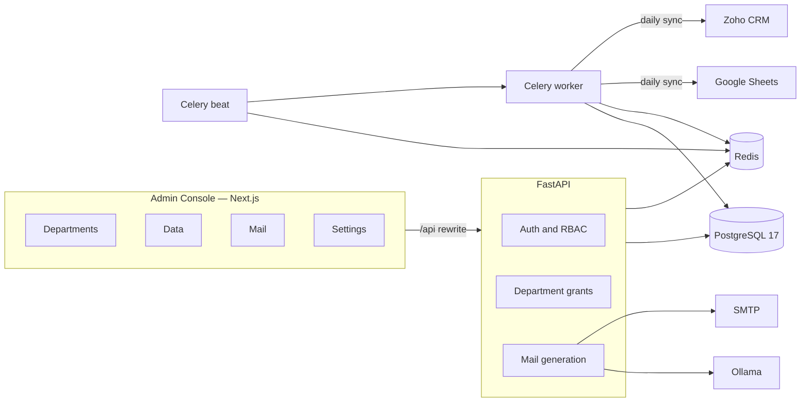
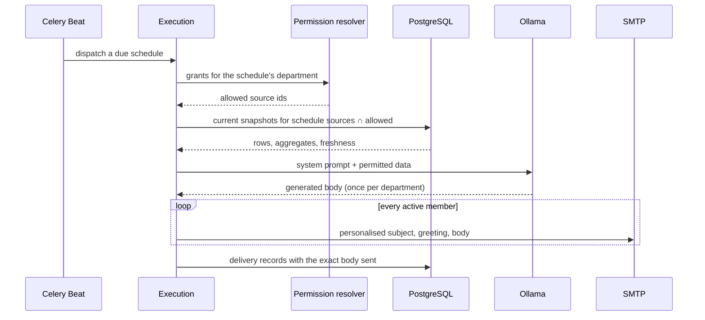
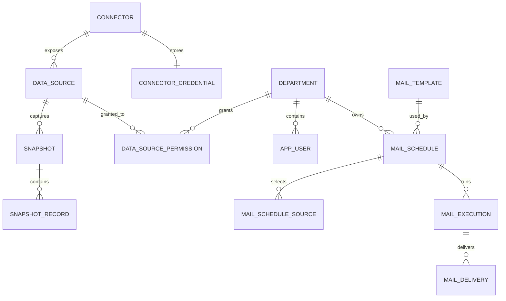

<div align="center">

# Dossier

**Organisational intelligence for a single organisation.**

Connects the tools a company already uses, snapshots them every day, and turns that data
into scheduled departmental emails — with permissions enforced **before** the model ever
sees a row.


</div>

---

## What it does

Dossier is an internal platform for one organisation. It has two layers and one console.

**The data layer** connects to Google Sheets and Zoho CRM, reads selected sheets and CRM
modules once a day, and stores each result as an immutable snapshot. Departments are
granted access to specific sources — never to a whole connector, never to individual rows.

**The mail engine** turns those snapshots into scheduled, department-specific emails.
An administrator writes a template as a natural-language system prompt. At send time the
engine resolves what the recipient's department may access, places only that data in the
prompt, generates one body per department, and sends a personalised message to each active
member.

**The Admin Console** is department-first. Opening a department shows its members, the
sources it may use, the emails it receives, and whether each step is ready.

There is deliberately **no chatbot**. The product is the data layer plus scheduled mail.

> The defining rule: **permissions are applied at the data layer, before generation.**
> The model cannot leak a source it never received.

---

## Architecture



### How an email is produced



### The two-key rule

A source appears in an email only when **both** keys turn:

```text
effective sources =
      schedule.sources                    (what this email is designed to use)
    ∩ department grants                   (what this department may ever use)
    ∩ active sources with a snapshot      (what actually has data)
```

Granting a source without adding it to a schedule does nothing. Adding it to a schedule
without granting it does nothing. If the intersection is empty, every recipient is recorded
as `SKIPPED` and nothing is sent — the email never hints that other data exists.

---

## Tech stack

| Layer | Technology | Why |
|---|---|---|
| Console | Next.js 16 (App Router), React 19, TypeScript 5.9 | Server-rendered shell, fast client navigation, typed API boundary |
| Styling | Tailwind CSS 4, shadcn/ui, Radix | A consistent design system without a bespoke component library |
| API | FastAPI, Pydantic 2, SQLAlchemy 2 (async), Alembic | Async I/O, generated OpenAPI, explicit migrations |
| Database | PostgreSQL 17, pgvector extension | Relational integrity; JSONB for flexible snapshots |
| Cache / queue | Redis 8 | Rate limiting, sync locks, Celery broker |
| Background | Celery 5.6 + Celery Beat | Daily syncs and per-minute schedule dispatch |
| LLM | Ollama (provider-agnostic protocol) | Mail bodies generated from admin prompts |
| Integrations | Google Sheets API, Zoho CRM API v8 | Service account and refresh-token flows |
| Mail | SMTP (Mailhog in development) | Admin-configured, encrypted credentials |
| Deployment | Docker Compose for services; Vercel for the console | Long-running workers do not fit a serverless platform |

---

## The department-first console

The home page is the department list. Everything else is either shared plumbing or
organisation-wide settings.

| Area | Routes | Purpose |
|---|---|---|
| **Departments** | `/departments`, `/departments/[id]` | Home. A workspace per department: Overview, Sources, Emails, Members |
| **Data** | `/data/connectors`, `/data/sources` | Connect providers and register the sheets/modules that become sources |
| **Mail** | `/mail/templates`, `/mail/settings`, `/mail/executions` | Content definitions, SMTP, and the delivery log |
| **Settings** | `/settings/organisation`, `/settings/users`, `/settings/audit` | Organisation profile, accounts, append-only audit trail |

A schedule belongs to **exactly one department**. Creating an email from a department
defaults the recipients to its active members and the sources to everything it is granted.
That makes the department page truthful: what you edit under Sales affects only Sales.

---

## Data model



| Entity | Meaning |
|---|---|
| **Connector** | A credentialed connection to an external system |
| **Data source** | One usable asset exposed by a connector: a sheet tab or CRM module |
| **Snapshot** | An immutable daily capture of a source, with rows and schema metadata |
| **Department grant** | A department's permission over one data source |
| **Mail template** | A subject template plus a system prompt |
| **Mail schedule** | A department-owned cadence that binds a template, sources, and recipients |
| **Mail execution / delivery** | One run, and one record per recipient with the exact body sent |

---

## Security model

| Control | Implementation |
|---|---|
| Authentication | Argon2id passwords; 15-minute access JWT; 7-day rotating opaque refresh token |
| Refresh reuse detection | A replayed token revokes the whole token family |
| Authorisation | `ADMIN` vs `USER`; admin routes guarded at the router level |
| Data access | Department → allowed source ids, resolved before any snapshot is read |
| Fail-closed | An empty allowed set means no data, never all data |
| Encryption at rest | Connector and SMTP credentials with a key-id-scoped Fernet key, rotatable |
| Non-disclosure | A department with no permitted source is skipped; no refusal names restricted data |
| Audit | Configuration changes written in the same transaction as the change |
| Login protection | Redis-backed rate limiting per IP and email |
| Prompt injection | Snapshot cells are delimited and labelled untrusted; recipients are fixed by configuration |

---

## Repository layout

```text
Dossier/
├── backend/
│   ├── app/
│   │   ├── api/            routers, dependencies, health
│   │   ├── auth/           login, refresh rotation, cookies, rate limit
│   │   ├── users/          accounts, last-admin rule
│   │   ├── departments/    departments, source grants
│   │   ├── organisation/   profile and timezone
│   │   ├── connectors/     base protocol, Google Sheets, Zoho CRM, encryption
│   │   ├── data_sources/   registration and permission matrix
│   │   ├── sync/           sync jobs and transactional snapshot promotion
│   │   ├── snapshots/      immutable captures and rows
│   │   ├── mail/           templates, schedules, generation, SMTP, execution
│   │   ├── llm/            provider protocol and Ollama adapter
│   │   ├── workers/        Celery app, daily sync, mail dispatch
│   │   ├── permissions/    fail-closed permission context
│   │   └── audit/          append-only audit log
│   ├── migrations/         Alembic revisions 0001-0004
│   └── tests/              unit and API tests
├── frontend/
│   ├── src/app/            routes and layouts
│   ├── src/components/     UI primitives and admin components
│   ├── src/lib/            API client, types, formatting
│   └── e2e/                Playwright journeys
├── docker-compose.yml      db, redis, backend, worker, beat, mailhog
└── organisational_intelligence_product_specification.md
```

---

## Local development

### Prerequisites

- Docker Desktop (running)
- Python 3.11+ and `uv`
- Node.js 24+ and `pnpm`
- Ollama reachable from the backend, with a chat model available

### Quickstart

```powershell
# 1. Configure
Copy-Item .env.example .env
#    Set JWT_SECRET (32+ bytes) and CREDENTIAL_ENCRYPTION_KEYS.
#    Generate an encryption key:
#      python -c "from cryptography.fernet import Fernet; print(Fernet.generate_key().decode())"

# 2. Start infrastructure, API, workers, and the development mail sink
docker compose up -d db redis backend mailhog
docker compose --profile workers up -d worker beat

# 3. Migrate, create the first administrator, and seed demo data
docker compose exec backend alembic upgrade head
docker compose exec backend python -m app.cli bootstrap
docker compose exec backend python -m app.cli seed-demo

# 4. Run the console
pnpm --dir frontend install
pnpm --dir frontend dev
```

| Service | URL |
|---|---|
| Console | <http://localhost:3000> |
| API docs | <http://localhost:8000/docs> |
| Mailhog | <http://localhost:8025> |

`bootstrap` prints a one-time administrator password. Change it with:

```powershell
docker compose exec backend python -m app.cli set-password `
  --email admin@example.com --password "your-password"
```

### Walk the demo

1. Open **Departments → General**.
2. **Sources** shows the seeded *Demo Sales Pipeline* already granted.
3. **Emails → New email** — pick a template (create one under **Mail → Templates** first),
   set a cadence, and send now.
4. Watch the generated body in **Mail → Executions**, and the delivered message in Mailhog.

To use real data, add a connector under **Data → Connectors**:

- **Google Sheets** — service-account email and private key; share the spreadsheet with
  the service account as a viewer.
- **Zoho CRM** — client id, client secret, and refresh token from a Self Client.

Then register its assets under **Data → Sources** and grant them to a department.

---

## Testing

| Suite | Command |
|---|---|
| Backend | `cd backend && uv sync && uv run pytest --cov=app --cov-fail-under=80` |
| Lint | `cd backend && uv run ruff check .` |
| Types | `cd backend && uv run mypy app` |
| Frontend types | `pnpm --dir frontend typecheck` |
| Frontend build | `pnpm --dir frontend build` |
| Browser journeys | `pnpm --dir frontend test:e2e` |

The backend suite covers authentication, refresh rotation, permission resolution, sync
failure isolation, snapshot promotion, generation isolation, SMTP retries, schedule
idempotency, and the cross-department leakage regression.

The Playwright suite needs the console and API running, and a known administrator
password. Set it before running:

```powershell
docker compose exec backend python -m app.cli set-password `
  --email admin@example.com --password "E2E-Admin-Password-2026"

$env:E2E_ADMIN_EMAIL = "admin@example.com"
$env:E2E_ADMIN_PASSWORD = "E2E-Admin-Password-2026"
pnpm --dir frontend test:e2e
```

---

## Deployment

### The split

Vercel can host the **console**. It cannot host the rest of the product: Dossier needs a
long-lived FastAPI process, Celery workers and a scheduler, PostgreSQL with pgvector, Redis,
persistent local credentials, and SMTP. Vercel is a serverless platform, so the backend
belongs on a container host.

```text
Browser
   │
   ▼
Vercel  ──  Next.js console  ──/api rewrite──▶  FastAPI (container host)
                                                   │
                                        ┌──────────┼──────────┐
                                        ▼          ▼          ▼
                                     PostgreSQL   Redis     Celery
                                                             │
                                                       Ollama + SMTP
```

### Frontend on Vercel

1. Import the repository in Vercel.
2. Set **Root Directory** to `frontend`.
3. Framework preset: **Next.js** (auto-detected).
4. Add an environment variable **before the first build**:

   | Variable | Value |
   |---|---|
   | `BACKEND_URL` | The public HTTPS URL of the FastAPI service |

   `next.config.ts` compiles the `/api` rewrite at build time, so changing this value
   requires a redeploy.

5. Deploy. Or from the CLI:

```powershell
cd frontend
vercel login
vercel --prod
```

The browser stays same-origin: cookies are first-party on the Vercel domain and no CORS
configuration is required for the console.

### Backend on a container host

Run the Compose services on a VPS, or on a container platform that supports long-running
workers. In production you need:

- PostgreSQL 17 with the `vector` extension (the application enables it, but the image
  must provide it — the `pgvector/pgvector:pg17` image does).
- Redis.
- `backend` (FastAPI), `worker` (Celery), `beat` (Celery Beat).
- A reverse proxy with TLS in front of the API.
- An SMTP provider, configured in **Mail → SMTP settings**.

Set at minimum:

| Variable | Production value |
|---|---|
| `APP_ENV` | `production` |
| `DATABASE_URL` | `postgresql+asyncpg://...` |
| `REDIS_URL` | `redis://...` |
| `JWT_SECRET` | 32+ random bytes; never reuse the example |
| `CREDENTIAL_ENCRYPTION_KEYS` | `v1:<fernet-key>` (generate a fresh one) |
| `CREDENTIAL_ENCRYPTION_ACTIVE_KEY_ID` | `v1` |
| `COOKIE_SECURE` | `true` |
| `CORS_ORIGINS` | Optional; only needed if the API is called directly rather than through the rewrite |
| `OLLAMA_BASE_URL` | A reachable Ollama endpoint |
| `OLLAMA_CHAT_MODEL` | The chat model to generate with |

Run `alembic upgrade head` once per deploy, then `bootstrap` to create the organisation and
first administrator.

### Production checklist

- [ ] Fresh `JWT_SECRET` and `CREDENTIAL_ENCRYPTION_KEYS`, backed up outside the repo
- [ ] HTTPS everywhere; `COOKIE_SECURE=true`
- [ ] Database backups and a restore drill
- [ ] SMTP test send from the deployed environment
- [ ] At least one non-bootstrap administrator account
- [ ] A verified connector and a completed sync before relying on the mail engine

---

## Configuration

Backend variables live in `.env` (see `.env.example`). The important ones:

| Variable | Purpose |
|---|---|
| `DATABASE_URL`, `REDIS_URL` | PostgreSQL and Redis connection strings |
| `JWT_SECRET` | Access-token signing key, 32+ bytes |
| `CREDENTIAL_ENCRYPTION_KEYS` | `key_id:fernet_key` pairs for connector and SMTP secrets |
| `ACCESS_TOKEN_TTL_MINUTES`, `REFRESH_TOKEN_TTL_DAYS` | Session lifetimes |
| `COOKIE_SECURE` | Must be `true` behind HTTPS |
| `OLLAMA_BASE_URL`, `OLLAMA_CHAT_MODEL` | Mail generation provider |
| `DAILY_SYNC_HOUR_UTC` | When the daily connector sync runs |
| `MAIL_MAX_ROWS_PER_SOURCE` | Sample rows per source in a prompt (default 50) |
| `MAIL_AGGREGATE_ROW_CAP` | Rows considered for numeric aggregates (default 2000) |
| `MAIL_MAX_PROMPT_CHARS` | Hard cap on assembled context (default 30000) |
| `MAIL_SEND_RETRIES` | SMTP attempts per delivery (default 3) |

Frontend: `BACKEND_URL` only, read at build time.

---

## Design decisions

| Decision | Rationale |
|---|---|
| Permissions before retrieval | The filter is a SQL/data-layer guarantee, not a prompt instruction |
| Connector and data source are separate | Rotate one credential without touching grants or schedules; grant one sheet without granting the account |
| A schedule belongs to one department | What you edit under a department only affects that department |
| Templates are system prompts | The administrator writes intent; the model writes the body from permitted data |
| Subjects are deterministic Jinja2 | Predictable, testable, and independent of the model |
| One generation per department | Recipients with identical data share a call; greetings and signatures stay personal |
| Snapshots are immutable | A failed sync never damages the last good snapshot |
| Credentials are encrypted and key-scoped | Rotation without re-encrypting everything; secrets never leave the backend |
| No chatbot | The product is the data layer plus scheduled mail; unused surface was removed |
| HTTP-native API responses | Idiomatic FastAPI and a clean OpenAPI contract |

---

## Known limitations

- Live Google Sheets and Zoho CRM sync has not been exercised against production accounts;
  the adapters are covered by mocked HTTP tests. Zoho data-centre domains and a
  settings-scope fallback are the first things to verify with real credentials.
- Emails are plain text. HTML and AI-generated subjects are not implemented.
- Recipients are limited to active members of the scheduled department.
- There is no snapshot retention policy yet; snapshots accumulate.
- The `vector` extension remains enabled from an earlier design but no table uses it.

---

## Status

Internal, single-organisation deployment. Not multi-tenant. No public sign-up: accounts are
created by an administrator.

The requirements that shaped the product are in
[`organisational_intelligence_product_specification.md`](./organisational_intelligence_product_specification.md).
